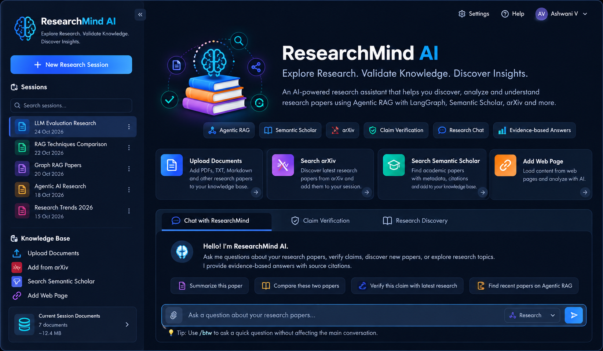

# ResearchMind AI

### Agentic Research Intelligence Assistant

**Explore Research. Validate Knowledge. Discover Insights.**

## Interface Preview




ResearchMind AI is a Streamlit-based research assistant that uses **agentic retrieval-augmented generation (Agentic RAG)** to analyze research documents, answer contextual questions, discover academic papers, and investigate research claims using external sources. Research conversations and their indexed documents are organized by session.

> **Project status:** Portfolio / development project. The modules have been reviewed individually; the complete integrated application, API access, and deployment have not yet been verified end to end.

## Features

- **Document-grounded questions:** Upload PDFs, text files, and Markdown files; ingest webpages and ask questions about their contents.
- **Academic paper discovery:** Search and load papers from **arXiv** and **Semantic Scholar**. Semantic Scholar full-text ingestion requires an accessible open-access PDF.
- **Agentic RAG:** A LangGraph workflow routes queries, retrieves relevant context, checks relevance, can rewrite queries, and generates answers.
- **Research claim verification:** Investigate claims using external research and web search; results are evidence-based assistance, not a guarantee of scientific validity.
- **Session-specific knowledge bases:** Qdrant collections separate documents between research sessions.
- **Persistent conversation checkpoints:** LangGraph uses a SQLite checkpointer; session metadata is stored in `sessions.json`.
- **Side questions:** Prefix a question with `/btw` to get a response without adding that exchange to the main research conversation.
- **Evaluation:** DeepEval-based tests for retrieval and answer quality.
- **Research workspace:** A custom-styled Streamlit UI for sessions, document ingestion, academic search, and chat.

## Architecture

```mermaid
flowchart TD
    U[Researcher] --> UI[Streamlit UI - app.py]
    UI --> ING[Document and paper ingestion]
    ING --> SRC[PDF / TXT / Markdown / URL / arXiv / Semantic Scholar]
    SRC --> CH[Parsing and chunking]
    CH --> EMB[OpenAI embeddings with local cache]
    EMB --> Q[Qdrant - session-specific collections]
    UI --> LG[LangGraph research workflow]
    LG --> ROUTE{Query routing}
    ROUTE --> RAG[Retrieve and answer]
    ROUTE --> VERIFY[Claim verification]
    ROUTE --> DIRECT[Direct response]
    RAG --> Q
    RAG --> WEB[Tavily / Semantic Scholar search]
    VERIFY --> WEB
    LG --> LLM[OpenAI chat model]
    LG --> CP[SQLite checkpoints]
    UI --> BTW[/btw side-question handler]
```

### Technology stack

| Layer | Technology |
|---|---|
| UI | Python, Streamlit |
| Agent orchestration | LangGraph, LangChain |
| LLM | OpenAI via `langchain-openai` |
| Embeddings | `text-embedding-3-small` |
| Vector database | Qdrant Cloud / Qdrant API |
| Academic sources | arXiv, Semantic Scholar Graph API |
| Web search | Tavily |
| Document processing | PyMuPDF, LangChain loaders and text splitters |
| Conversation persistence | LangGraph SQLite checkpointer |
| Evaluation | DeepEval |

## Project structure

```text
ResearchMind-AI/
├── app.py                   # Streamlit research workspace
├── main.py                  # Optional Streamlit launcher
├── evaluate.py              # RAG evaluation with DeepEval
├── requirements.txt         # Python dependencies
├── .env                     # Local secrets (do not commit)
├── .gitignore               # Exclude secrets and generated data
├── sessions.json            # Session metadata (auto-updated)
├── goldens.json             # Evaluation questions / expected answers, if generated
├── documents/               # Local papers for evaluation (optional)
└── backend/
    ├── __init__.py
    ├── rag_graph.py          # Routing, retrieval, verification, answer generation
    ├── vector_store.py       # Qdrant and cached embeddings
    ├── paper_loader.py       # Files, URLs, arXiv and Semantic Scholar ingestion
    ├── models.py             # Structured model schemas
    └── btw_handler.py        # Independent side-question handler
```

Runtime files such as `checkpoints.db`, `eval_checkpoints.db`, `embedding_cache/`, and `eval_results.json` may be created during use.

## Getting started

### 1. Prerequisites

- Python 3.11 or later, subject to compatibility with the pinned dependencies
- An OpenAI API key
- A Tavily API key
- A reachable Qdrant instance and API key
- Optionally, a Semantic Scholar API key (recommended for authenticated API access and applicable rate limits)

### 2. Clone and create a virtual environment

```bash
git clone <YOUR_REPOSITORY_URL>
cd ResearchMind-AI
python -m venv .venv
```

Activate it:

**Windows PowerShell**

```powershell
.venv\Scripts\Activate.ps1
```

**macOS / Linux**

```bash
source .venv/bin/activate
```

### 3. Install dependencies

```bash
python -m pip install -r requirements.txt
python -m pip check
```

### 4. Configure environment variables

Create `.env` in the project root:

```dotenv
OPENAI_API_KEY=your_openai_api_key
TAVILY_API_KEY=your_tavily_api_key
QDRANT_URL=https://your-qdrant-endpoint
QDRANT_API_KEY=your_qdrant_api_key
SEMANTIC_SCHOLAR_API_KEY=your_optional_semantic_scholar_api_key
```

Do not commit real API keys. Qdrant credentials and endpoint must match your Qdrant deployment. Some Semantic Scholar API calls may work without a key, but access and rate limits can differ.

### 5. Launch

```bash
streamlit run app.py
```

Alternatively:

```bash
python main.py
```

Open the local address shown by Streamlit (typically `http://localhost:8501`).

## Using ResearchMind AI

1. **Create or select a session** in the sidebar.
2. **Build a knowledge base:** upload local documents, load webpage URLs, find an arXiv paper, or search Semantic Scholar and select a paper to ingest.
3. **Ask grounded questions**, such as: “Summarize the methodology of the uploaded paper” or “What limitations do the authors identify?”
4. **Verify a claim**, such as: “Has this paper's main conclusion been superseded by more recent research?” The workflow may consult current external sources.
5. **Ask a side question** using `/btw What is contrastive learning?` without storing that exchange in the main conversation.
6. **Switch sessions** to work with separate document collections and research histories.

**Semantic Scholar note:** Search results and abstracts are useful for discovery, but they are not equivalent to ingesting the full paper. Full-text ingestion is supported only when an accessible open-access PDF can be retrieved.

## RAG workflow

The agent can choose among three high-level routes:

- **Retrieve:** Find relevant passages in the session's Qdrant knowledge base and, where appropriate, use external research tools. The workflow includes relevance checks and a limited query-rewrite/retry loop.
- **Verify claim:** Search external evidence and produce a structured assessment, including potentially superseding publications when supported by available evidence.
- **Direct answer:** Respond to questions that do not require retrieval or verification.

The agent's outputs can be inspected using the expandable graph-state view in the UI. Research answers should be independently checked before being used for consequential decisions.

## Evaluation

`evaluate.py` uses **DeepEval** and can generate synthetic question/answer pairs from a PDF, execute RAG queries, and save metric results.

The five configured metrics are:

| Metric | Purpose |
|---|---|
| Contextual Precision | Relevance ordering of retrieved context |
| Contextual Recall | Coverage of evidence needed for the expected answer |
| Contextual Relevancy | Relevance of retrieved passages to the query |
| Answer Relevancy | Whether the answer addresses the question |
| Faithfulness | Whether claims in the answer are grounded in retrieved context |

The default threshold in the evaluation script is **0.7** per metric.

```bash
python evaluate.py --pdf documents/Openclaw_Research_Report.pdf
```

To regenerate synthetic evaluation questions:

```bash
python evaluate.py --pdf documents/Openclaw_Research_Report.pdf --regenerate-goldens
```

Use an existing PDF path. Generating and grading evaluations calls paid model APIs and may incur costs. The evaluation primarily measures document-grounded RAG; it is not a full benchmark of Semantic Scholar discovery or claim-verification correctness.

## Security and operational considerations

- Keep `.env`, API keys, checkpoint databases, and local embedding caches out of version control.
- Uploaded or externally retrieved documents are untrusted input; do not treat instructions inside research papers or webpages as system instructions.
- External services (OpenAI, Qdrant, Tavily, Semantic Scholar, arXiv) require network connectivity and can impose usage limits or charges.
- SQLite checkpointing and local session metadata are appropriate for a development setup; production multi-user deployments require a review of persistence, concurrency, access control, and backup strategy.
- Session-specific vector collections provide logical separation, **not** user authentication or authorization. Do not treat them as a security boundary for untrusted users.
- PDF availability, publisher licensing, and paper metadata quality vary by source.

## Recommended integration checks

- [ ] Start Streamlit with all required environment variables.
- [ ] Upload a PDF, ingest it, and ask a grounded question.
- [ ] Search arXiv and load a paper.
- [ ] Search Semantic Scholar and ingest an accessible open-access PDF.
- [ ] Verify that research sessions have separate Qdrant collections.
- [ ] Restart the application and check conversation restoration.
- [ ] Confirm `/btw` responses do not enter main chat history.
- [ ] Run DeepEval and review `eval_results.json`.
- [ ] Test failure behavior for missing API keys, rate limits, and unavailable PDFs.

## Roadmap

Potential enhancements include source-linked citations, richer research comparisons, explicit evidence-quality scoring, retrieval and generation tracing, automated regression evaluation, production authentication, and a more scalable persistence backend.

## License

No license is declared in this README. Add a `LICENSE` file before distributing or reusing the project under specific terms.
